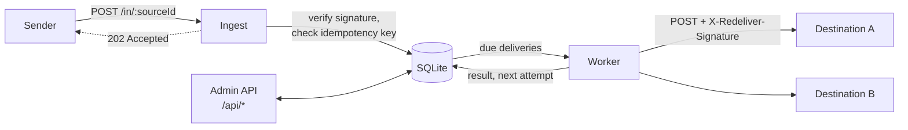
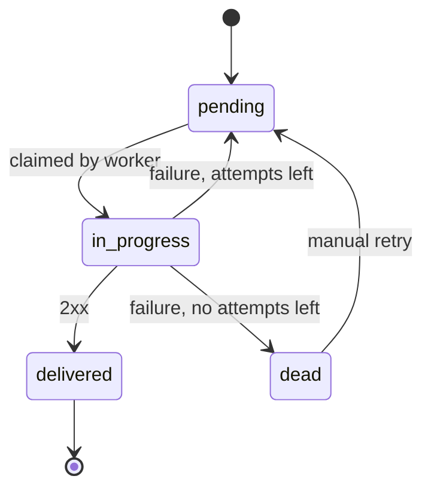

# redeliver

[](https://github.com/rezarg-dev/redeliver/actions/workflows/ci.yml)


A small, self-hosted webhook relay. It takes a webhook at the door, checks
who sent it, and makes sure it reaches every recipient, even if they are not
home on the first try.

```
GitHub / Stripe / your shop  ──►  redeliver  ──►  service A
                                     │       ──►  service B
                                  SQLite     ──►  service C (down, retried later)
```

## Why

Webhooks are sent once, or a handful of times, and then they are gone. If the
receiving service is being deployed, crashed, or simply slow at that moment,
the event is lost and you find out days later. Every service that consumes
webhooks ends up re-implementing the same things: signature checks,
deduplication, retries, some way to look at what arrived.

redeliver puts that in one place. Senders talk to redeliver, which answers
within milliseconds and stores the event. Delivery to your services happens in
the background, with retries, and every attempt is on record.

## Features

- **Signature verification** on the raw request bytes (generic HMAC-SHA256 and
  GitHub's `X-Hub-Signature-256`), compared in constant time
- **Fan-out**: one source can feed any number of destinations
- **Retries** with exponential backoff and jitter, honouring `Retry-After`
- **Idempotency**: a repeated `Idempotency-Key` (or GitHub delivery id) never
  causes a second delivery
- **Replay** a stored event, or **retry** a single failed delivery, through the API
- **Pause** a destination without losing its backlog
- **Attempt history** per delivery: status code, error, duration
- **Signed outgoing requests**, so destinations can trust redeliver
- **Crash safe**: event and deliveries are written in one transaction, and
  interrupted deliveries are requeued on startup
- **Prometheus metrics** on `/metrics`, health check on `/healthz`
- One process, one SQLite file, two runtime dependencies

## How it works



A **source** is where webhooks come in. It has an id, a signing scheme and a
secret. A **destination** is a URL that should receive everything a source
gets. Each incoming request becomes an **event**, and for every destination a
**delivery** is created that the worker drives to completion:



More detail on the design and its trade-offs is in
[docs/architecture.md](docs/architecture.md).

## Getting started

Requires Node.js 22.12 or newer.

```bash
git clone https://github.com/rezarg-dev/redeliver.git
cd redeliver
npm install

cp .env.example .env
# set ADMIN_TOKEN in .env, for example with:
node -e "console.log(require('crypto').randomBytes(24).toString('base64url'))"

npm start
```

The server listens on port 3000 and creates `data/redeliver.db` on first start.

### Try it in two minutes

You need three terminals. The first one runs `npm start`.

**Terminal 2** starts a throwaway receiver that fails its first two requests:

```bash
node scripts/receiver.js --port 9000 --fail 2
```

**Terminal 3** creates a source and a destination, then sends a signed webhook:

```bash
export TOKEN=<your ADMIN_TOKEN>

curl -s -X POST localhost:3000/api/sources \
  -H "authorization: Bearer $TOKEN" -H 'content-type: application/json' \
  -d '{"name":"shop"}'
# {"id":"src_-lVoFAW40LO-0a_N","name":"shop","scheme":"hmac-sha256",
#  "ingest_path":"/in/src_-lVoFAW40LO-0a_N","secret":"whsec_iS00GUi8...", ...}

curl -s -X POST localhost:3000/api/sources/<source id>/destinations \
  -H "authorization: Bearer $TOKEN" -H 'content-type: application/json' \
  -d '{"url":"http://localhost:9000/hook"}'

node scripts/send.js http://localhost:3000/in/<source id> <secret> '{"order":42}'
# 202 {"id":"evt_27NVhjVPpAIs81ik","deliveries":1}
```

The receiver shows the two simulated failures and the retry that gets through:

```
21:53:10.760  dlv_gSufEDE_ScXbiUTk  attempt 1  ->  503 (simulated failure)  {"order":42}
21:53:16.112  dlv_gSufEDE_ScXbiUTk  attempt 2  ->  503 (simulated failure)  {"order":42}
21:53:24.875  dlv_gSufEDE_ScXbiUTk  attempt 3  ->  200  {"order":42}
```

`GET /api/deliveries/<delivery id>` then lists all three attempts.

### Using it with GitHub

Create the source with `"scheme": "github"`, then add a webhook in your
repository settings with

- **Payload URL**: `https://<your host>/in/<source id>`
- **Secret**: the `secret` redeliver returned when the source was created

redeliver verifies `X-Hub-Signature-256`, passes `X-GitHub-Event` on to your
destinations and recognises redeliveries by their `X-GitHub-Delivery` id.

## Configuration

All settings are environment variables. `npm start` also reads a `.env` file
if there is one.

| Variable | Default | Description |
| --- | --- | --- |
| `ADMIN_TOKEN` | *required* | Bearer token for the admin API, at least 16 characters |
| `HOST` | `0.0.0.0` | Address to bind to |
| `PORT` | `3000` | Port to listen on |
| `LOG_LEVEL` | `info` | `fatal`, `error`, `warn`, `info`, `debug`, `trace` or `silent` |
| `DATABASE_PATH` | `./data/redeliver.db` | SQLite file, created if missing |
| `MAX_BODY_BYTES` | `262144` | Largest webhook body accepted (256 KiB) |
| `WORKER_POLL_MS` | `1000` | How often the worker looks for due deliveries |
| `WORKER_CONCURRENCY` | `4` | Deliveries sent in parallel |
| `DELIVERY_TIMEOUT_MS` | `10000` | Time a destination has to answer |
| `MAX_ATTEMPTS` | `12` | Attempts before a delivery is marked `dead` |
| `BACKOFF_BASE_MS` | `5000` | Upper bound of the first retry delay |
| `BACKOFF_MAX_MS` | `3600000` | Longest delay between two attempts (1 hour) |

Invalid values stop the server at startup with a list of everything that is
wrong.

## Receiving webhooks

```
POST /in/:sourceId
```

Any content type and any body up to `MAX_BODY_BYTES` is accepted. The body is
never parsed, it is stored and forwarded byte for byte.

| Response | Meaning |
| --- | --- |
| `202` `{"id": "evt_…", "deliveries": 2}` | Stored and queued for two destinations |
| `200` `{"id": "evt_…", "duplicate": true}` | Same idempotency key as an earlier event, nothing queued |
| `401` | Signature missing or wrong |
| `404` | Unknown source |
| `413` | Body too large |

### Signature schemes

| Scheme | Header | Format | Idempotency key taken from |
| --- | --- | --- | --- |
| `hmac-sha256` (default) | `X-Signature` | hex HMAC-SHA256 of the body, optional `sha256=` prefix | `Idempotency-Key` |
| `github` | `X-Hub-Signature-256` | `sha256=<hex>` | `Idempotency-Key`, else `X-GitHub-Delivery` |
| `none` | – | no verification | `Idempotency-Key` |

`none` exists for senders that cannot sign. Treat the ingest URL of such a
source as a secret.

## What destinations receive

A `POST` with the original body and content type, the sender's custom `x-*`
headers (for example `X-GitHub-Event`), and:

| Header | Content |
| --- | --- |
| `X-Redeliver-Event` | Event id |
| `X-Redeliver-Delivery` | Delivery id, the same across retries. Use it to deduplicate. |
| `X-Redeliver-Attempt` | Attempt number, starting at 1 |
| `X-Redeliver-Signature` | `sha256=<hex HMAC of the body>`, only if the destination has a secret |

`Authorization`, `Cookie` and proxy headers of the original request are never
stored or forwarded.

Verifying the signature on the receiving side:

```js
import { createHmac, timingSafeEqual } from 'node:crypto';

function isFromRedeliver(rawBody, signatureHeader, secret) {
  const digest = createHmac('sha256', secret).update(rawBody).digest('hex');
  const expected = Buffer.from(`sha256=${digest}`);
  const given = Buffer.from(signatureHeader ?? '');
  return given.length === expected.length && timingSafeEqual(given, expected);
}
```

### Delivery rules

- A `2xx` answer within `DELIVERY_TIMEOUT_MS` counts as delivered. Everything
  else is a failure: other status codes, timeouts, connection errors, and
  redirects (which are not followed).
- After a failure the delivery waits and is tried again. The wait doubles
  each time and is randomised within the upper half of its window, so many
  failed deliveries do not all come back at the same moment.
- If the destination sends `Retry-After`, redeliver waits at least that long
  (up to `BACKOFF_MAX_MS`).
- After `MAX_ATTEMPTS` failures the delivery is `dead` and stays that way
  until someone retries it through the API.
- Delivery is **at-least-once**. If redeliver is killed while a request is in
  flight it cannot know whether it arrived, and sends it again after restart.

With the default settings:

| After failed attempt | Wait before the next one |
| --- | --- |
| 1 | 2.5 – 5 s |
| 2 | 5 – 10 s |
| 3 | 10 – 20 s |
| 4 | 20 – 40 s |
| 5 | 40 – 80 s |
| 6 | 1.3 – 2.7 min |
| 7 | 2.7 – 5.3 min |
| 8 | 5.3 – 10.7 min |
| 9 | 10.7 – 21.3 min |
| 10 | 21.3 – 42.7 min |
| 11 | 30 – 60 min |
| 12 | none, the delivery is marked `dead` |

That adds up to between roughly 1¼ and 2½ hours of trying.

## Admin API

All routes are under `/api` and need `Authorization: Bearer <ADMIN_TOKEN>`.
Requests and responses are JSON. Errors always look like
`{"error": "<code>", "message": "<text>"}`.

| Method and path | Description |
| --- | --- |
| `POST /api/sources` | Create a source. Body: `name`, optional `scheme`. The `secret` is only shown in this response. |
| `GET /api/sources` | List sources |
| `GET /api/sources/:id` | Get one source |
| `DELETE /api/sources/:id` | Delete a source with its destinations, events and deliveries |
| `POST /api/sources/:id/destinations` | Add a destination. Body: `url`, optional `secret` (min. 8 characters) |
| `GET /api/sources/:id/destinations` | List the destinations of a source |
| `PATCH /api/destinations/:id` | Change `url`, `secret` or `enabled`. `{"enabled": false}` pauses it. |
| `DELETE /api/destinations/:id` | Delete a destination and its deliveries |
| `GET /api/events` | List events, newest first. Query: `source_id`, `limit`, `cursor` |
| `GET /api/events/:id` | Event with headers, body and its deliveries |
| `POST /api/events/:id/replay` | Queue the event again for every enabled destination |
| `GET /api/deliveries` | List deliveries, newest first. Query: `status`, `event_id`, `limit`, `cursor` |
| `GET /api/deliveries/:id` | Delivery with its attempt history |
| `POST /api/deliveries/:id/retry` | Make a `dead` or waiting delivery due now, with a fresh attempt budget |

Lists return `{"data": [...], "next_cursor": 123}`. Pass `next_cursor` as
`cursor` to get the next page; it is `null` on the last one. `limit` goes up
to 100 and defaults to 50.

Some examples:

```bash
# everything that has been given up on
curl -s "localhost:3000/api/deliveries?status=dead" -H "authorization: Bearer $TOKEN"

# why did it fail?
curl -s localhost:3000/api/deliveries/dlv_gSufEDE_ScXbiUTk -H "authorization: Bearer $TOKEN"
# { "status": "dead", "attempts": 12, "last_error": "ECONNREFUSED",
#   "history": [ { "attempt": 1, "status_code": null, "error": "ECONNREFUSED", "duration_ms": 3, ... }, ... ] }

# the service is fixed, send it again
curl -s -X POST localhost:3000/api/deliveries/dlv_gSufEDE_ScXbiUTk/retry -H "authorization: Bearer $TOKEN"

# pause a destination during maintenance, resume it later
curl -s -X PATCH localhost:3000/api/destinations/dst_Ay8fxA_4aWQjGi3w \
  -H "authorization: Bearer $TOKEN" -H 'content-type: application/json' -d '{"enabled":false}'
```

Event bodies are returned as text when they are valid UTF-8 and as base64
otherwise; `body_encoding` says which.

## Monitoring

`GET /healthz` returns `200 {"status":"ok"}` while the database answers and
`503` otherwise.

`GET /metrics` serves Prometheus text format:

| Metric | Type | Labels |
| --- | --- | --- |
| `redeliver_events_received_total` | counter | `source` |
| `redeliver_events_duplicate_total` | counter | `source` |
| `redeliver_events_rejected_total` | counter | `reason` (`invalid_signature`, `unknown_source`) |
| `redeliver_delivery_attempts_total` | counter | `outcome` (`delivered`, `retry`, `dead`) |
| `redeliver_deliveries` | gauge | `status` |
| `redeliver_uptime_seconds` | gauge | – |

Two alerts that are worth having: `redeliver_deliveries{status="dead"} > 0`,
and a `redeliver_deliveries{status="pending"}` that keeps growing.

Both endpoints are unauthenticated. If redeliver is reachable from the
internet, expose only `/in/*` through your reverse proxy.

## Development

```bash
npm test        # node:test, runs against in-memory SQLite, no network
npm run lint
npm run dev     # restarts on file changes
```

```
src/
  server.js          entry point: wiring, signal handling
  app.js             Fastify app, takes its dependencies as arguments
  config.js          environment variables -> validated config object
  db.js              opens SQLite, applies migrations
  migrations/        numbered .sql files
  store/             all SQL lives here, one file per table
  routes/            HTTP handlers (ingest, admin API, health, metrics)
  worker.js          delivery loop
  backoff.js         retry delay and Retry-After parsing
  signature.js       signing and the verification schemes
  headers.js         which headers are stored and forwarded
  metrics.js         minimal Prometheus exporter
scripts/             send.js and receiver.js for local experiments
test/                one file per area, helpers in test/support
```

The worker gets `fetch`, the clock and the random source passed in. Tests
replace them, so retry schedules are checked to the millisecond without a
single real timeout.

## Limitations

Things redeliver deliberately does not do (yet):

- **One instance only.** The queue is a table in a local SQLite file, and the
  worker assumes it is the only one claiming deliveries. Running two instances
  on the same file is not supported.
- **No ordering guarantee.** Deliveries are sent in parallel and retried
  independently, so a destination can see event 2 before event 1.
- **No retention.** Events are kept until their source is deleted.
- **Secrets are stored in plain text** in the database file. Protect the file
  like you would protect the secrets.
- **Destination URLs are not restricted.** Whoever holds the admin token can
  make redeliver send requests to internal addresses. Keep the token private.

Ideas for later: automatic clean-up of old events, per-destination filters on
headers, a circuit breaker that pauses a destination after repeated failures,
and a small web UI on top of the API.

## License

[MIT](LICENSE)
